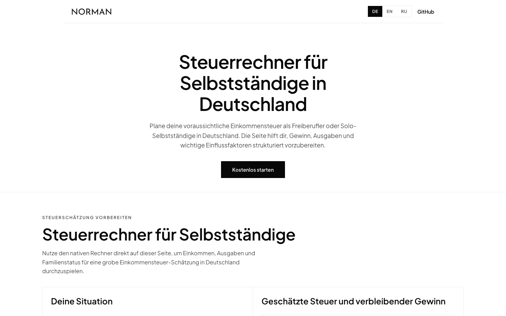
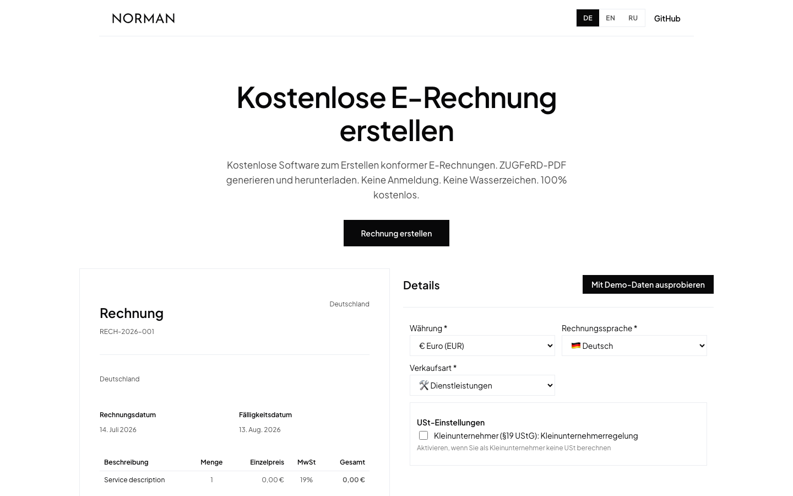
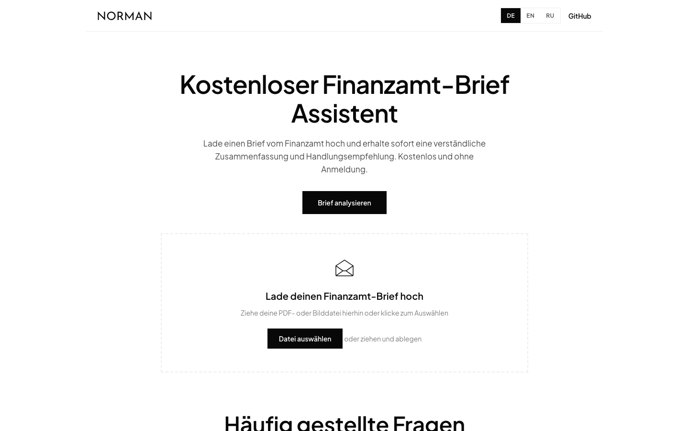
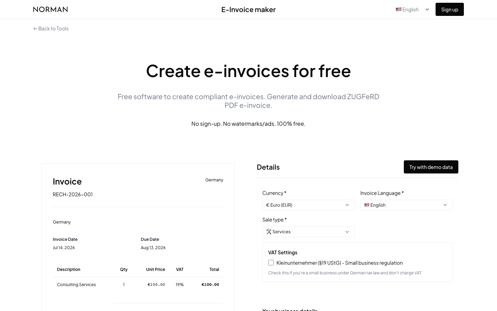
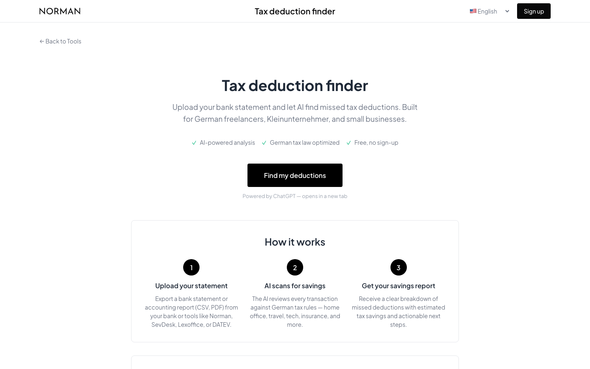

<div align="center">
   <a href="https://norman.finance/?utm_source=github_tools">
      
   </a>
   <h1>Norman Free Tools</h1>
   <p>Free, open-source mini-tools for freelancers and small businesses in Germany.<br/>
   Invoicing, e-invoices, tax letters, and tax estimates — no sign-up, no watermarks, 100% free.</p>
   <br/>
   <p>
      
      
      
      
   </p>
   <strong>Deutsch</strong> &nbsp;·&nbsp; <strong>English</strong> &nbsp;·&nbsp; <strong>Русский</strong>
</div>
<br/>

---

<br/>

### The tools

Every tool in this repo is a **fully standalone Next.js mini-app**: copy one folder anywhere, `npm install && npm run dev`, done. Use them live on [norman.finance](https://norman.finance/de/tools?utm_source=github_tools) or self-host your own copy.

| Tool | What it does | Live | Source |
|:--|:--|:--|:--|
| **Tax Calculator** | Estimate German income tax, solidarity surcharge, and health insurance for the self-employed — fully client-side | [norman.finance](https://norman.finance/de/steuerrechner?utm_source=github_tools) | [`apps/tax-calculator`](apps/tax-calculator) |
| **E-Invoice Generator** | Create compliant ZUGFeRD PDF e-invoices with live totals and VAT logic (§19, reverse charge) | [norman.finance](https://norman.finance/de/tools/erechnung?utm_source=github_tools) | [`apps/e-invoice-generator`](apps/e-invoice-generator) |
| **Tax Letter Assistant** | AI that explains Finanzamt letters in plain language — urgency, deadlines, required actions | [norman.finance](https://norman.finance/de/tools/finanzamt-brief?utm_source=github_tools) | [`apps/tax-letter-assistant`](apps/tax-letter-assistant) |
| **Invoice Generator** | Classic invoice maker with a live preview and PDF output | [tools.norman.finance](https://tools.norman.finance/erechnung?utm_source=github_tools) | [`apps/invoice-generator`](apps/invoice-generator) |
| **Steuer-Check** | Tax-deduction finder companion — scans bank statements for missed deductions via a custom GPT | [tools.norman.finance](https://tools.norman.finance/steuer-check?utm_source=github_tools) | [`apps/steuer-check`](apps/steuer-check) |

<br/>

---

<br/>

## 🚀 Run any tool locally

```bash
git clone https://github.com/norman-finance/norman-tools.git
cd norman-tools/apps/tax-calculator   # or any other tool
npm install                           # pnpm works too
npm run dev
```

Each app folder is self-contained — no workspace dependencies, no shared packages. You can copy a single `apps/<tool>` folder out of this repo and it still builds and runs.

To work on all tools at once, use pnpm from the repo root:

```bash
pnpm install
pnpm build                    # builds every app
pnpm dev:tax-calculator       # or dev:e-invoice-generator, dev:tax-letter-assistant, ...
```

<br/>

---

<br/>

## The tools in detail

<details>
<summary><strong>🧮 Tax Calculator</strong> — <code>apps/tax-calculator</code></summary>
<br/>



Estimate your yearly German taxes as a freelancer or solo self-employed: income tax (Einkommensteuer), solidarity surcharge (Solidaritätszuschlag), and statutory health + care insurance — with marital status and children factored in.

- 100% client-side: no backend, no data leaves the browser
- German 2024 tax brackets with single/married splitting
- Statutory health insurance (14% + Zusatzbeitrag) and care insurance with child discounts
- Languages: Deutsch, English, Русский

**Environment:** none.

</details>

<details>
<summary><strong>🧾 E-Invoice Generator</strong> — <code>apps/e-invoice-generator</code></summary>
<br/>



Create German-compliant e-invoices with a live preview: client and company details, VAT handling (Kleinunternehmer §19 UStG, EU reverse charge, §3a), 18 currencies, and ZUGFeRD PDF output.

- Live invoice preview and totals while you type
- Smart VAT recommendations based on client country and sale type
- Invoice PDF language: German or English; UI also in Russian
- PDF/ZUGFeRD generation happens via Norman's **free public API** (`api.norman.finance`) — no key required

**Environment:**

| Variable | Required | Description |
|:--|:--|:--|
| `NEXT_PUBLIC_INVOICE_API_URL` | no | Override the generation endpoint (default: `https://api.norman.finance`) |

</details>

<details>
<summary><strong>✉️ Tax Letter Assistant</strong> — <code>apps/tax-letter-assistant</code></summary>
<br/>



Upload a letter from the German tax office (PDF, JPG, or PNG) and get a plain-language summary: what it says, how urgent it is, the deadline, and what to do next — with follow-up questions.

- PDFs are parsed client-side (PDF.js); only extracted text is sent to the API
- Personal data (names, addresses, tax IDs, IBANs) is redacted **before** any AI call
- Explicit AI-consent checkbox, enforced server-side
- Rate limiting per IP + global daily budget (in-memory, or Upstash Redis if configured)

**Environment:**

| Variable | Required | Description |
|:--|:--|:--|
| `OPENAI_API_KEY` | **yes** | OpenAI key used by the analysis route (gpt-4.1) |
| `UPSTASH_REDIS_REST_URL` | no | Upstash Redis for cross-instance rate limiting |
| `UPSTASH_REDIS_REST_TOKEN` | no | — |

</details>

<details>
<summary><strong>📄 Invoice Generator</strong> — <code>apps/invoice-generator</code></summary>
<br/>



The classic Norman invoice maker: a full invoice form with a live side-by-side preview, German + English invoice output, and professional PDF download.

- Live preview updates as you type
- VAT logic incl. Kleinunternehmer and EU reverse charge
- URL-shareable state (`?ui_lang=de`)
- PDF generation via Norman's free public API — no key required

**Environment:**

| Variable | Required | Description |
|:--|:--|:--|
| `NEXT_PUBLIC_API_URL` | no | Override the generation endpoint (default: `https://api.norman.finance`) |

</details>

<details>
<summary><strong>🔎 Steuer-Check</strong> — <code>apps/steuer-check</code></summary>
<br/>



A companion page for the **Steuer-Spar-Scout** custom GPT: upload a bank statement export and let AI scan every transaction for missed deductions — home office, travel, tech, insurance, and more.

- Static page, no backend and no keys
- Links out to the free custom GPT (ChatGPT account required there)
- Languages: Deutsch, English

**Environment:** none.

</details>

<br/>

---

<br/>

## Repository structure

```
norman-tools/
├── apps/
│   ├── tax-calculator/        # client-side German income-tax calculator
│   ├── e-invoice-generator/   # ZUGFeRD e-invoice generator (public API)
│   ├── tax-letter-assistant/  # AI Finanzamt-letter explainer (OpenAI)
│   ├── invoice-generator/     # classic invoice maker with live preview
│   └── steuer-check/          # tax-deduction finder companion (GPT)
├── assets/                    # screenshots + logo for this README
└── .github/workflows/         # CI: builds every app + standalone check
```

Every app ships its own `package.json`, `README.md`, and (where relevant) `.env.example` and `Dockerfile`.

<br/>

## Self-hosting

Each app builds to a standalone Next.js server:

```bash
cd apps/tax-letter-assistant
npm install && npm run build
OPENAI_API_KEY=sk-... npm start
```

Apps with a `Dockerfile` can be containerized directly — secrets are runtime-only, never baked into the image:

```bash
docker build -t tax-letter-assistant apps/tax-letter-assistant
docker run -p 3000:3000 -e OPENAI_API_KEY=sk-... tax-letter-assistant
```

<br/>

## Contributing

Issues and PRs are welcome — from copy fixes to new tools. If you build something useful for freelancers in Germany on top of these apps, we'd love to hear about it.

<br/>

---

<br/>

<p align="center">
   Found a bug or have a tool idea? <a href="../../issues"><strong>Open an issue →</strong></a>
</p>

<br/>

<p align="center">
   <a href="https://norman.finance/?utm_source=github_tools">
      
   </a>
   <br/><br/>
   <sub>Make business effortless</sub>
</p>
