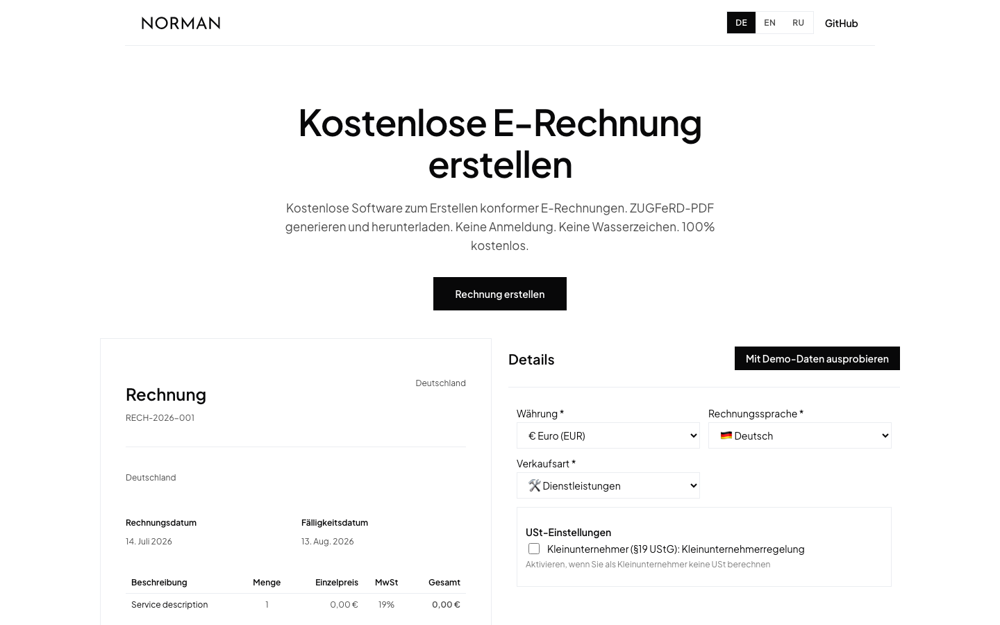

# E-Invoice Generator

Free ZUGFeRD e-invoice generator for Germany — live totals, smart VAT logic, compliant PDF output. No sign-up, no watermarks.

<p>
   <a href="https://norman.finance/de/tools/erechnung?utm_source=github_tools"></a>
   
</p>



## Features

- Live invoice preview and totals while you type
- VAT handling for Kleinunternehmer (§19 UStG), EU reverse charge, and §3a services — with automatic recommendations based on client country and sale type
- 18 currencies, invoice PDF in German or English
- Demo-data mode to try it in one click
- UI languages: Deutsch, English, Русский
- Form validation with zod + react-hook-form

## Quick start

```bash
npm install
npm run dev
# open http://localhost:3000
```

This folder is fully standalone — copy it anywhere.

## Configuration

| Variable | Required | Description |
|:--|:--|:--|
| `NEXT_PUBLIC_INVOICE_API_URL` | no | Override the PDF generation endpoint. Defaults to `https://api.norman.finance` |

## How it works

The form, live preview, totals, and VAT logic are fully client-side (`lib/e-invoice/`). On download, the invoice JSON is POSTed to Norman's **free public endpoint** `POST /api/v1/invoices/public/generate/`, which renders the ZUGFeRD-compliant PDF and returns it as a blob — no account or key needed.

## Project structure

```
app/            # Next.js app router: layout, page, client app shell
components/     # generator widget (+ CSS module), CTA banner, page shell
lib/e-invoice/  # types, constants, calculations, VAT logic, validation, translations, API client
```

---

<sub>Part of <a href="https://github.com/norman-finance/norman-tools">Norman Free Tools</a> · Make business effortless</sub>
