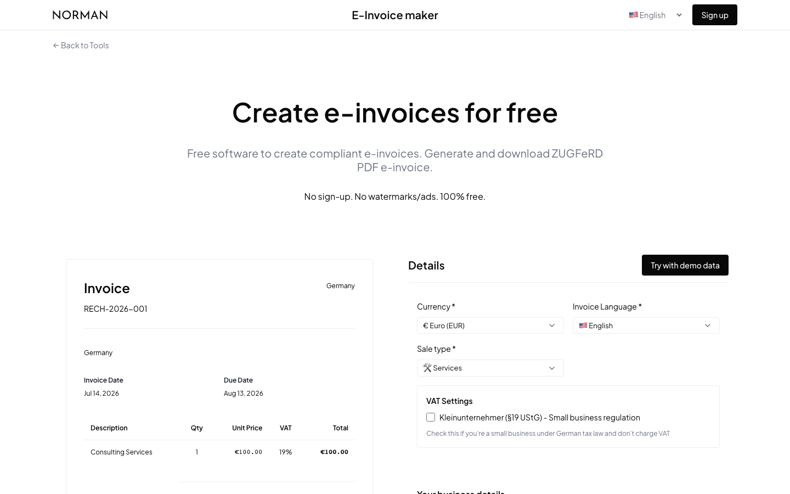

# Invoice Generator

Classic free invoice maker with a live side-by-side preview and professional PDF output — German and English invoices, no sign-up. Self-host it, or use the newer [E-Invoice Generator](https://norman.finance/de/tools/erechnung?utm_source=github_tools) live on norman.finance.

<p>
   
</p>



## Features

- Full invoice form with a live preview that updates as you type
- VAT logic incl. Kleinunternehmer (§19 UStG) and EU reverse charge
- Independent UI language and invoice language (Deutsch / English)
- Shareable state via URL params (`?ui_lang=de`)
- Professional PDF download via Norman's free public API

## Quick start

```bash
npm install
npm run dev
# open http://localhost:3000
```

This folder is fully standalone — copy it anywhere.

## Configuration

| Variable | Required | Description |
|:--|:--|:--|
| `NEXT_PUBLIC_API_URL` | no | Override the PDF generation endpoint. Defaults to `https://api.norman.finance` |

## How it works

Form state, validation (zod + react-hook-form), and the preview are fully client-side. On download, the invoice JSON is POSTed to Norman's **free public endpoint** `POST /api/v1/invoices/public/generate/`, which returns the rendered PDF — no account or key needed.

## Project structure

```
src/app/           # layout + the invoice tool page
src/components/    # InvoiceForm, InvoicePreview, UI bits (header, footer, messages)
src/lib/           # constants, validation, VAT logic, API client
src/locales/       # UI and invoice translations (en/de)
src/utils/         # calculations, invoice translations, URL params
```

---

<sub>Part of <a href="https://github.com/norman-finance/norman-tools">Norman Free Tools</a> · Make business effortless</sub>
