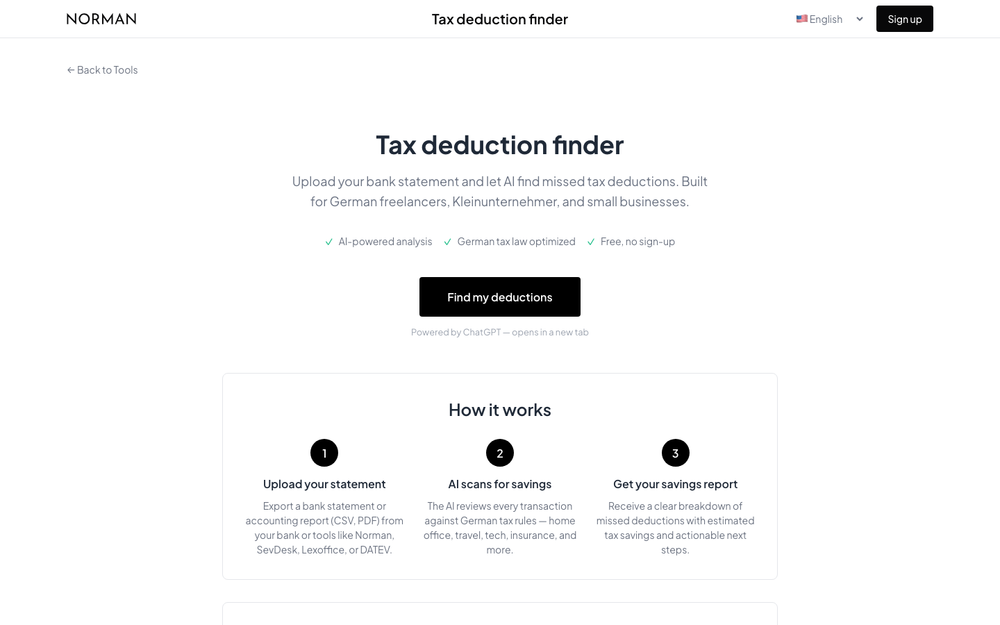

# Steuer-Check (Tax Deduction Finder)

Companion page for the **Steuer-Spar-Scout** custom GPT: upload a bank statement and let AI scan every transaction for missed German tax deductions.

<p>
   
</p>



## Features

- Explains the 3-step flow: export statement → AI scans by German tax law → savings report
- Covers 12 deduction categories (home office, tech, travel, insurance, marketing, …)
- Links out to the free custom GPT (a ChatGPT account is needed there)
- Static page: no backend, no keys, nothing to configure
- Languages: Deutsch, English

## Quick start

```bash
npm install
npm run dev
# open http://localhost:3000
```

This folder is fully standalone — copy it anywhere.

## Configuration

None.

## Project structure

```
src/app/           # layout + landing page
src/components/    # header + footer
src/locales/       # UI translations (en/de)
```

---

<sub>Part of <a href="https://github.com/norman-finance/norman-tools">Norman Free Tools</a> · Make business effortless</sub>
