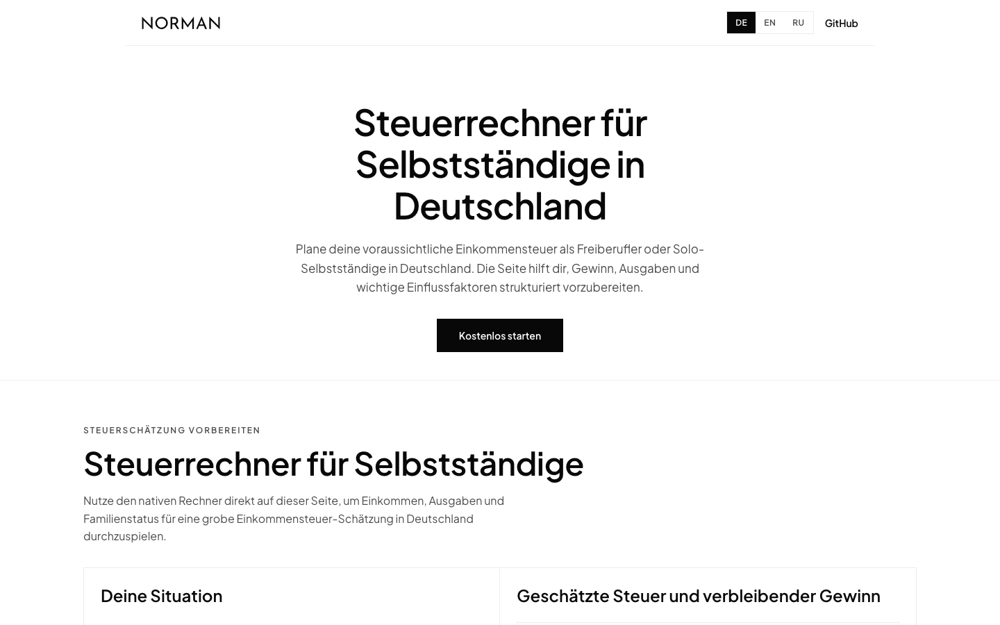

# Tax Calculator

Free German income-tax calculator for freelancers and the self-employed — fully client-side, no data leaves the browser.

<p>
   <a href="https://norman.finance/de/steuerrechner?utm_source=github_tools"></a>
   
</p>



## Features

- Income tax (Einkommensteuer) with German 2024 bracket formulas, single/married splitting
- Solidarity surcharge (Solidaritätszuschlag) with phase-in logic
- Statutory health insurance (14% + 1.2% Zusatzbeitrag) and care insurance with child discounts, min/max income bands
- Interactive sliders for income and expenses, instant recalculation
- Languages: Deutsch, English, Русский (switcher + `?lang=` deep link)
- Zero backend: the whole calculation lives in [`lib/tax-calculator.ts`](lib/tax-calculator.ts)

## Quick start

```bash
npm install
npm run dev
# open http://localhost:3000
```

Works with pnpm/yarn/bun too. This folder is fully standalone — copy it anywhere.

## Configuration

None. No environment variables, no API keys.

## How it works

`lib/tax-calculator.ts` is a pure, dependency-free TypeScript module implementing the German tax math. The UI (`components/tax-calculator.tsx`) renders sliders and result cards; all copy for the three languages lives in `lib/content.ts`.

## Project structure

```
app/            # Next.js app router: layout, page, client app shell
components/     # calculator widget (+ CSS module) and minimal page shell
lib/            # tax math, tri-locale content, locale helpers
```

## Disclaimer

The results are estimates based on average rates and assumptions — not tax advice and not a definitive figure.

---

<sub>Part of <a href="https://github.com/norman-finance/norman-tools">Norman Free Tools</a> · Make business effortless</sub>
