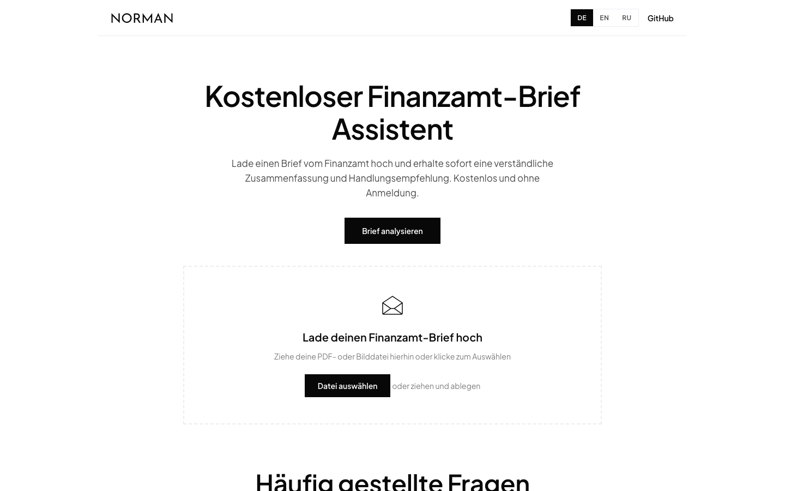

# Tax Letter Assistant

AI assistant that explains German tax office (Finanzamt) letters in plain language: summary, urgency, deadline, and required actions — with follow-up questions.

<p>
   <a href="https://norman.finance/de/tools/finanzamt-brief?utm_source=github_tools"></a>
   
</p>



## Features

- Upload PDF, JPG, or PNG (max 10 MB)
- PDFs are parsed **client-side** with PDF.js — only the extracted text is sent to the server
- German PII (names, addresses, tax IDs, IBANs, dates) is redacted **before** any AI call
- Explicit AI-consent checkbox, enforced server-side
- Urgency classification + deadline detection, follow-up chat
- Rate limiting: per-IP and a global daily budget (in-memory, or Upstash Redis for multi-instance)
- Languages: Deutsch, English, Русский

## Quick start

```bash
npm install
cp .env.example .env       # add your OpenAI key
npm run dev
# open http://localhost:3000
```

This folder is fully standalone — copy it anywhere.

## Configuration

| Variable | Required | Description |
|:--|:--|:--|
| `OPENAI_API_KEY` | **yes** | Used by `app/api/finanzamt-analysis` (model: gpt-4.1) |
| `UPSTASH_REDIS_REST_URL` | no | Upstash Redis for cross-instance rate limiting |
| `UPSTASH_REDIS_REST_TOKEN` | no | — |

Without Upstash, an in-memory limiter is used — fine for a single instance.

## How it works

1. Images are sent as files to the API route and analyzed with OpenAI Vision; PDFs are text-extracted in the browser (`pdfjs-dist`, worker served from `public/pdf.worker.min.mjs`) and sent as text.
2. The route (`app/api/finanzamt-analysis/route.ts`) sanitizes personal data, enforces consent and rate limits, then asks gpt-4.1 for a structured analysis: `{ summary, keyPoints, actionRequired, urgency, deadline }`.

> **Note:** `pdfjs-dist` is pinned exactly — the static worker file must match the library version. If you upgrade it, re-copy `node_modules/pdfjs-dist/build/pdf.worker.min.mjs` into `public/`.

## Tests

```bash
npm test   # vitest — rate limiter unit tests
```

## Project structure

```
app/                    # layout, page, client shell + api/finanzamt-analysis route
components/             # analyzer widget (+ CSS module), FAQ, CTA, page shell
lib/finanzamt-letter/   # API client, translations, rate limiter, PII sanitizer
public/pdf.worker.min.mjs
```

---

<sub>Part of <a href="https://github.com/norman-finance/norman-tools">Norman Free Tools</a> · Make business effortless</sub>
